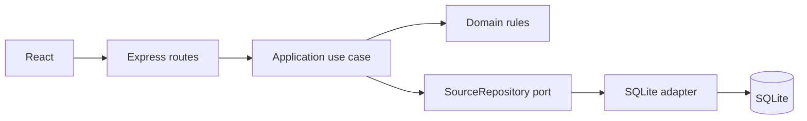

# Thiết kế nền tảng Radar

Radar chạy dưới dạng web cá nhân. React phục vụ giao diện, Express phục vụ API, SQLite lưu dữ liệu cục bộ. Bản build production chạy chung trong một tiến trình Node.js và một container. Cổng HTTP mặc định chỉ mở trên localhost.

## Luồng đã có



Bảng `feed_sources` lưu UUID, tên nguồn, URL feed, thị trường, mục sử dụng và trạng thái bật/tắt. URL chuẩn hóa và duy nhất trong từng mục sử dụng. `schema_migrations` ghi nhận các script đã chạy. Mỗi lần cập nhật trạng thái ghi giá trị đích để xử lý được request gửi lại.

`/api/sources` đọc hoặc thêm nguồn. `PATCH /api/sources/:id` đặt trạng thái nguồn. `/api/bulletins/latest` đọc bản tổng hợp mới nhất. `/api/bulletins/stories` gộp bài đã thu thập với bài thuộc bản tin, ưu tiên bài đã biên tập theo ngày khi trùng URL. Truyền `bulletinDate` để xem đúng bài nguồn của một bản tin. Các yêu cầu ghi cần header `X-Radar-Request`.

`/api/rankings/latest` đọc nhận định thủ công mới nhất. Radar lưu theo ngày, giữ thang 75 cho đợt sàng lọc cũ và dùng thang 100 cho phương pháp `MARKET`, bổ sung dư địa cạnh tranh và phù hợp với Việt Nam. Hướng có nhà cung cấp lớn trùng tệp khách và quy trình có `rank: null`. Các hướng còn lại dùng cùng thứ hạng khi đồng điểm. `MARKET` yêu cầu nguồn kiểm chứng cho nhu cầu, triển vọng AI, độ phù hợp ở Việt Nam và từng đối thủ. Ngành có dự báo có điều kiện, ngách có cách thử với khách hàng.

`/api/library` đọc tài liệu chọn lọc theo URL gốc. `PATCH /api/library/bookmark` đặt trạng thái đã lưu. Nhập lại nội dung cập nhật tài liệu và giữ trạng thái lưu. Danh sách nguồn RSS/Atom đăng ký được quản lý ở cùng trang Quản trị nguồn.

`npm run collect` đọc các feed đang bật theo thứ tự, kiểm tra `robots.txt` và giới hạn tốc độ, rồi lưu tin vào `collected_stories` hoặc cập nhật danh mục Thư viện. Bản ghi từ feed giữ trích đoạn ngắn và bỏ qua URL đã có để giữ nội dung biên tập và trạng thái lưu.

## Mở rộng theo tính năng

1. **Phân tích và lên lịch bản tin.** Lọc bằng từ khóa rồi mới gọi model xử lý tin cho bài đủ liên quan. Dùng model phân tích để tổng hợp kết luận và dự báo. Cặp model được chọn qua `RADAR_AI_PROFILE` trong `.env`. Job 06:00 giờ Việt Nam ghi nhận mỗi lần chạy theo ngày để thử lại và chạy bù. Trần AI theo ngày lấy từ ngân sách còn lại sau chi phí VPS, với tổng tối đa 500.000 đồng/tháng.
2. **Ngành, ngách và dự báo.** Gom tín hiệu theo tuần. Xếp điểm nhu cầu, cạnh tranh thấp, khả năng kiếm tiền, khả năng làm tay trái và đà tăng trưởng. Hiển thị dữ liệu tham chiếu, mức tin cậy, dự báo 1–3 tháng và 6–12 tháng. Dữ liệu đối thủ còn ít thì ghi rõ chưa đủ dữ liệu cạnh tranh.
3. **Thư viện.** Dùng lại luồng RSS/Atom cho blog, newsletter và kênh YouTube khi có feed công khai. Lưu nội dung hay và ghi chú case study, rồi liên kết với ngành hoặc ngách liên quan.

## Menu đề xuất

Thứ tự menu sau khi mở rộng: Bản tin sáng, Kho tin, Công việc phụ, **Nghề dịch vụ**, **AIoT & Chatbot**, Nông nghiệp ở quê, Thư viện. Trên điện thoại, thanh menu có 7 mục nên cần cuộn ngang hoặc gom hai menu mới vào nhóm "Ngách". Quy tắc chọn dữ liệu cho hai menu nằm trong [CRAWL_RULES.md](CRAWL_RULES.md) mục 6 và 7.

Cách phân vai giữa ba menu:

- **Công việc phụ** xếp hạng mọi ngách trên cùng một thang điểm.
- **Nghề dịch vụ** và **AIoT & Chatbot** là trang đào sâu. Mỗi mục ở đây có hồ sơ chi tiết.
- Khi một hồ sơ đổi quyết định `PILOT`, `VALIDATE` hoặc `EXCLUDE`, bản xếp hạng mới của Công việc phụ dùng lại cùng `id` và nguồn.

### Nghề dịch vụ (`/nghe-dich-vu`)

**Câu hỏi menu trả lời:** Với 8 nghề dịch vụ có thể làm tay trái, khách đang trả bao nhiêu, AI làm thay được phần nào, mình cần học gì và nên bán gói nào?

8 nghề (mã `ServiceLine`):

| Mã | Nghề |
| --- | --- |
| `CONTENT` | Viết nội dung |
| `DESIGN` | Thiết kế |
| `VIDEO` | Dựng video |
| `TRANSLATION` | Dịch |
| `CUSTOMER_CARE` | Chăm sóc khách |
| `BOOKKEEPING` | Kế toán cơ bản |
| `CODING` | Viết code |
| `MARKET_RESEARCH` | Nghiên cứu thị trường |

**Bố cục:**

- Hàng thẻ tổng quan cho 8 nghề. Mỗi thẻ có quyết định, khoảng giá phổ biến, mức AI thay thế và số tín hiệu trong 30 ngày.
- Bấm một thẻ mở hồ sơ nghề, gồm các khối:
  - Nhu cầu.
  - Bảng giá thị trường.
  - AI làm được và chưa làm được.
  - Công cụ.
  - Lộ trình học trái ngành.
  - Gói dịch vụ mẫu.
  - Đối thủ và rủi ro.
  - Phép thử.
- Cuối hồ sơ là danh sách tin mới từ Kho tin và tài liệu từ Thư viện được gắn cùng mã nghề.

**Hợp đồng dữ liệu** (dự kiến đặt ở `shared/services.ts`, dùng lại `RankingSignal`, `RankingCompetitor` và `RankingDecision`):

```ts
export const serviceLines = ['CONTENT', 'DESIGN', 'VIDEO', 'TRANSLATION', 'CUSTOMER_CARE',
  'BOOKKEEPING', 'CODING', 'MARKET_RESEARCH'] as const;
export type ServiceLine = (typeof serviceLines)[number];

export interface ServicePrice {
  item: string;            // ví dụ: "Bài SEO 1.500 chữ", "Video ngắn 60 giây"
  low: number; high: number; currency: 'VND' | 'USD';
  unit: string;            // bài, phút video, trang, tháng…
  market: Market;
  observedOn: string;      // ngày ghi nhận giá
  sourceId: string;
}

export interface ServiceProfile {
  id: ServiceLine;
  date: string;
  decision: RankingDecision;
  demand: RankingSignal;
  prices: ServicePrice[];
  aiShift: { automated: string; stillHuman: string; replacementRisk: 'LOW' | 'MEDIUM' | 'HIGH' };
  tools: { name: string; use: string; cost: string; sourceId: string }[];
  learning: { weeks: number; prerequisites: string; path: string };
  offer: { name: string; deliverable: string; price: string; turnaround: string };
  competitors: RankingCompetitor[];
  legal?: RankingSignal;   // bắt buộc với BOOKKEEPING
  test: string;
  sources: RankingSource[];
}
```

**API và lưu trữ:**

- `GET /api/services/latest` đọc bản mới nhất của 8 hồ sơ.
- `GET /api/services/:id/history` đọc lịch sử để so sánh giá và quyết định theo thời gian.
- Migration mới tạo bảng `service_profiles (id, date, content)` với khóa `(id, date)`. Nhập theo ngày bằng `npm run import:services -- <file>.json`.
- Tin trong Kho tin và mục Thư viện nhận thêm trường tùy chọn `serviceLines: ServiceLine[]`, được gán ở bước chấm điểm.

### AIoT & Chatbot (`/aiot-chatbot`)

**Câu hỏi menu trả lời:** Thiết bị AIoT nào kèm chatbot có thể đóng gói và bán cho hộ gia đình, cửa hàng nhỏ hoặc trang trại ở Việt Nam? Linh kiện, nền tảng nào đang rẻ đi hoặc mạnh lên?

"Chatbot đính kèm" gồm hai dạng:

- Trợ lý giọng nói hoặc văn bản chạy trên thiết bị, ví dụ loa ESP32 nói chuyện, bộ điều khiển ao trả lời câu hỏi.
- Chatbot trên Zalo OA, Messenger hoặc web đi kèm thiết bị để báo trạng thái, nhận lệnh và trả lời khách.

**Bố cục:** ba tab.

1. **Giải pháp đóng gói.** Mỗi giải pháp có:
   - Bài toán và khách hàng.
   - Phần cứng và chi phí linh kiện (BOM).
   - Kênh chatbot.
   - Giá bán gồm phí lắp và phí tháng.
   - Đối thủ, quyết định và phép thử.
2. **Linh kiện & nền tảng.** Bo mạch, module cảm biến, micro và loa, model giọng nói, nền tảng chatbot. Mỗi mục có năng lực, giá theo ngày ghi nhận và nguồn. Thay đổi giá hoặc năng lực được đánh dấu là tín hiệu `ENABLER`.
3. **Tín hiệu.** Tin từ Kho tin có chủ đề `aiot`, `giong-noi` và chủ đề mới `chatbot`, lọc theo điểm ≥ 4.

**Hợp đồng dữ liệu** (dự kiến đặt ở `shared/aiot.ts`):

```ts
export const chatbotChannels = ['ON_DEVICE_VOICE', 'ZALO_OA', 'MESSENGER', 'WEB', 'TELEGRAM'] as const;
export const aiotPartKinds = ['BOARD', 'SENSOR', 'AUDIO', 'MODEL', 'CHATBOT_PLATFORM', 'CLOUD'] as const;

export interface AiotPart {
  id: string; name: string; kind: (typeof aiotPartKinds)[number];
  capability: string;
  price?: { value: number; currency: 'VND' | 'USD'; observedOn: string };
  sourceId: string;
}

export interface AiotSolution {
  id: string; title: string;
  problem: string; customer: string; market: Market;
  partIds: string[];
  bomCost: string;
  chatbot: { channels: (typeof chatbotChannels)[number][]; role: string; model: string };
  pricing: { setup: string; monthly?: string };
  competitors: RankingCompetitor[];
  decision: RankingDecision;
  pilot: string;
  risks: string;   // bảo trì, mất mạng, an toàn điện, dữ liệu người dùng
  sources: RankingSource[];
}

export interface AiotCatalog { date: string; parts: AiotPart[]; solutions: AiotSolution[]; sources: RankingSource[] }
```

**API và lưu trữ:**

- `GET /api/aiot/latest` đọc danh mục mới nhất.
- Migration mới tạo bảng `aiot_catalogs (date, content)`. Nhập bằng `npm run import:aiot -- <file>.json`.
- Thêm `chatbot` vào `newsTopics` cùng quy tắc nhận diện trong `story-topic.ts`, gồm: chatbot, Zalo OA, Messenger bot, trợ lý ảo, 聊天机器人, 客服机器人.
- Nông nghiệp ở quê giữ phần mô hình canh tác. Giải pháp AIoT cho ao, vườn đặt ở menu này và liên kết sang mô hình nông nghiệp liên quan qua `id`.

SQLite có thể lưu hàng đợi job theo trạng thái khi cần chạy bù và thử lại. Chỉ dùng Python nếu cần thư viện trích xuất bài công khai mà bộ thu Node.js chưa đáp ứng. Phần thu thập kiểm tra robots.txt và đặt giới hạn tần suất trước khi lấy nội dung trang.
